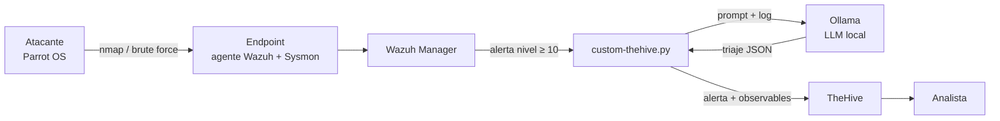

# SmartSOC: triaje de incidentes con IA local

Laboratorio SOC en Docker que convierte alertas de **Wazuh** en casos enriquecidos de **TheHive**, con un análisis generado por un **LLM local (Ollama)**. Ningún log sale de la infraestructura.

> Proyecto de mi TFM del *Máster en Dirección de Ciberseguridad, Hacking Ético y Seguridad Ofensiva* (abril 2026), reconstruido y mejorado para publicarlo.

## El problema

En un SOC, el analista N1 recibe cientos de alertas al día con logs en crudo. Abrir el log, interpretarlo, buscar la IP y crear el caso lleva de 10 a 15 minutos por alerta. Ese trabajo repetitivo es el origen de la *alert fatigue*.

## La solución



1. Wazuh detecta y dispara la integración para alertas de nivel 10 o superior.
2. `custom-thehive.py` envía el log al LLM local y le pide un **triaje estructurado**: resumen, táctica MITRE, severidad y acciones recomendadas.
3. Crea la alerta en TheHive con **observables** (IP, host), tags MITRE y severidad mapeada.
4. Si la IA no responde, la alerta se crea igualmente. El SOC nunca pierde un evento por culpa del LLM.

## Resultados de la prueba de concepto

| Tarea | Manual | Automatizado |
|---|---|---|
| Detección y triaje | 8–10 min | < 30 s |
| Análisis del log en crudo | 5 min | inmediato |
| Creación del caso en TheHive | 2–4 min | automático |
| **Total** | **≈ 15 min** | **< 1 min** |

Escenarios probados desde Parrot OS: reconocimiento con nmap y fuerza bruta. Los tiempos manuales son estimaciones del flujo habitual de un analista; los automatizados se midieron en el laboratorio.

## Stack

Wazuh 4.7.4 (SIEM/XDR) · Sysmon · TheHive 5.2 + Cassandra · Ollama (TinyLlama 1.1B por defecto) · Python · Docker Compose sobre WSL 2.

## Puesta en marcha

```bash
cp .env.example .env            # cambia las contraseñas
# Certificados del indexer (wazuh-docker single-node):
#   https://github.com/wazuh/wazuh-docker/tree/v4.7.4/single-node
docker compose up -d
docker compose exec ollama ollama pull tinyllama
```

Integración en el Manager:

```bash
docker compose cp integration/custom-thehive.py wazuh.manager:/var/ossec/integrations/custom-thehive
docker compose exec wazuh.manager sh -c "chown root:wazuh /var/ossec/integrations/custom-thehive && chmod 750 /var/ossec/integrations/custom-thehive"
# añade wazuh/ossec-integration.xml a ossec.conf con tu API key de TheHive y reinicia el manager
```

## Tests

```bash
pip install -r requirements.txt
pytest -q
```

Los tests cubren la extracción de IP (Linux y Windows/Sysmon), el mapeo de severidad, la degradación cuando la IA no responde y la construcción de la alerta con observables.

## Cambios respecto a la versión del TFM

- Credenciales fuera del `docker-compose` (en `.env`) y TLS configurable.
- Salida del LLM en **JSON estructurado** en lugar de texto libre.
- Observables, tags MITRE y severidad dinámica en TheHive (antes, severidad fija a 3).
- Filtro de IPs configurable (antes estaba fijado a las IPs del laboratorio).
- Ollama incluido en el compose; modelo configurable.
- Tests unitarios.

## Siguientes pasos

- Evaluar la calidad del triaje con un conjunto etiquetado de alertas (precisión de severidad y de MITRE) y comparar TinyLlama con modelos de 3B.
- Enriquecer con threat intel (AbuseIPDB, VirusTotal) antes del prompt.
- Respuesta activa: proponer el bloqueo de la IP con aprobación humana (SOAR).

## Autor

Alberto García Hernández · [GitHub](https://github.com/agher12)
